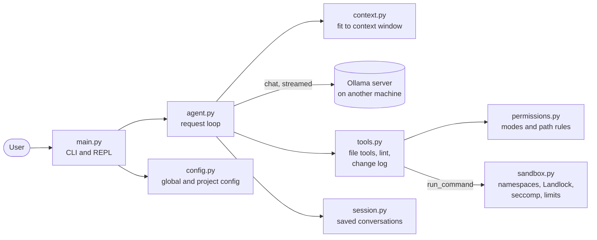
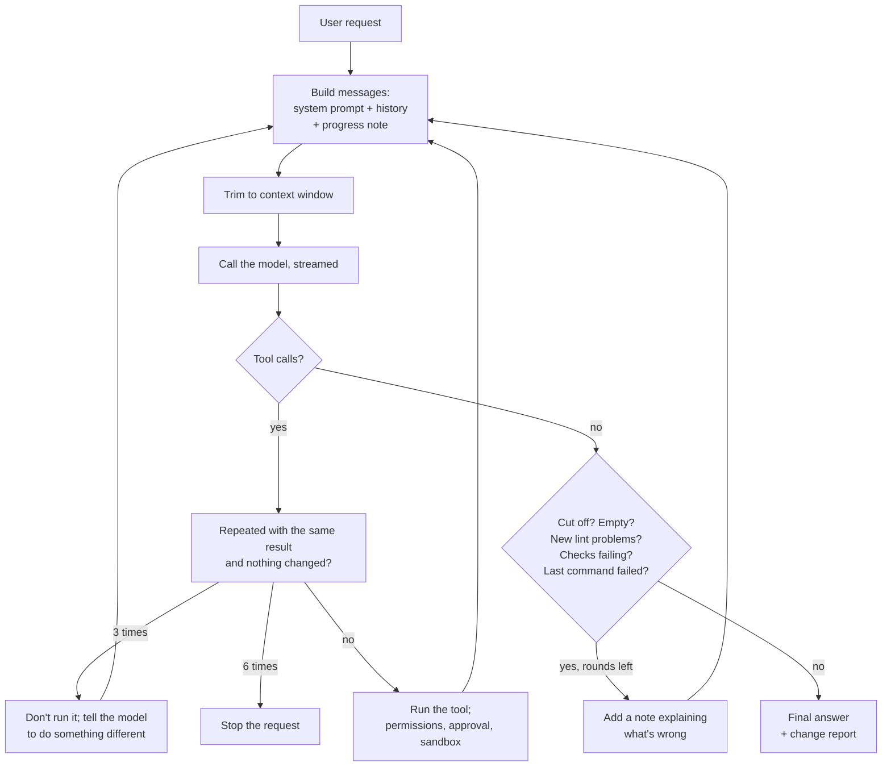

# Tinker: design and architecture

Tinker is a small coding agent written in Python. It drives a local language model served by
[Ollama](https://docs.ollama.com/api), gives the model tools to read and change the files of one workspace and to
run commands in a sandbox, and checks the model's work before accepting its answer. This document describes how it
is built and why, what it does to cope with the ways small local models fail, and where its limits are.

The [README](README.md) covers installation, configuration and day-to-day use;
[EVALUATION_RESULTS.md](EVALUATION_RESULTS.md) has measured results for several models. This document assumes you
have read the README.

## Contents

1. [Goals and constraints](#1-goals-and-constraints)
2. [Architecture overview](#2-architecture-overview)
3. [The request loop](#3-the-request-loop)
4. [Talking to Ollama](#4-talking-to-ollama)
5. [Keeping the conversation inside the context window](#5-keeping-the-conversation-inside-the-context-window)
6. [Tools](#6-tools)
7. [Permission modes](#7-permission-modes)
8. [Configuration and the trust boundary](#8-configuration-and-the-trust-boundary)
9. [The command sandbox](#9-the-command-sandbox)
10. [Checking the model's work](#10-checking-the-models-work)
11. [Sessions](#11-sessions)
12. [Evaluation](#12-evaluation)
13. [Testing](#13-testing)
14. [How Tinker was built](#14-how-tinker-was-built)
15. [The larger-task experiments](#15-the-larger-task-experiments)
16. [Limitations and future work](#16-limitations-and-future-work)
17. [References](#17-references)

## 1. Goals and constraints

**Goals**

- A working coding agent small enough to read in an afternoon: about 2,450 lines of Python, plus tests.
- Useful with **local models** of 9B–33B parameters, which are much less reliable than hosted frontier models.
  Much of the design exists to catch their mistakes rather than trust their reports.
- **Safe by default.** The model's code, and any text it reads, are untrusted. Changes are shown and approved, and
  commands the model runs are sandboxed so that a mistake or a prompt injection can't reach beyond the workspace.
- **Measurable.** An evaluation set ([`evals/`](evals/)) grades the code the agent leaves behind, not what it claims.

**Constraints**

- A proof of concept for local use: no backwards compatibility is kept between versions.
- The model runs on a **separate machine** on the network, reached over HTTP. If that machine is asleep,
  every request fails; Tinker says so rather than treating it as a bug.
- Commands are sandboxed with Linux kernel features, so `run_command` needs **Linux x86_64** with Landlock and
  unprivileged user namespaces. Development was done on WSL2 (kernel 6.6, Landlock ABI 3).
- Dependencies are kept to the [`ollama`](https://github.com/ollama/ollama-python) client library and
  [ruff](https://docs.astral.sh/ruff/) (for linting); everything else, including the sandbox, uses the standard
  library.

## 2. Architecture overview

| Module | Lines | Responsibility |
|---|---|---|
| [`main.py`](main.py) | 260 | Command line, the interactive REPL (with readline history), approval prompts, mode switching, printing tool calls and notices. |
| [`agent.py`](agent.py) | 510 | The request loop: system prompt, calling the model, recovering malformed tool calls, running tools, and the checks made before an answer is accepted. |
| [`context.py`](context.py) | 150 | Trims a copy of the conversation to fit the model's context window. |
| [`tools.py`](tools.py) | 800 | The tools the model can call, their JSON schemas, the per-request change log, lint and command change tracking. |
| [`permissions.py`](permissions.py) | 180 | Path pattern matching, the `Mode` class, and turning a mode's patterns into sandbox rules. |
| [`sandbox.py`](sandbox.py) | 270 | Runs one command inside new namespaces with Landlock, a seccomp filter and resource limits. Standard library only. |
| [`config.py`](config.py) | 205 | Loads the global `config.json`, and merges a project's `.tinker/config.json` under strict rules. |
| [`session.py`](session.py) | 80 | Saves and resumes conversations as JSON. |
| [`evals/run.py`](evals/run.py) | 300 | Runs the evaluation tasks and grades the results. |

Callbacks keep the agent independent of the terminal: `Agent` is constructed with `on_tool_call`, `on_notice`,
`confirm_write` and `confirm_command` functions. The REPL, one-shot runs, the evaluation runner and the tests each
supply their own.

## 3. The request loop

`Agent.ask()` handles one request from the user. Each pass through the loop is one model call; the loop ends when
the model gives a final answer that passes Tinker's checks, or after `max_iterations` calls (40 by default,
`--max-iterations` to override for one run).

Each step in more detail:

1. **System prompt.** A fixed prompt sets out how to work (explore before answering, read before editing, prefer
   small `edit_file` changes, run the tests, review the diff before answering) and how to report (accurately,
   without claiming anything that wasn't run). A **mode section** is generated from the current mode's rules (see
   [section 7](#7-permission-modes)). The prompt is rebuilt from the current code when a session is resumed.
2. **Progress note.** Once anything has happened in a request (a change, a failed or rejected edit, or a
   command), every model call ends with a note, built from the change log rather than from anything the model said: which files changed, failed edits, rejected changes,
   commands run and their results. It reminds the model of where it really is, and asks it to report failures.
   The note is added for that call only, not stored.
3. **Model call.** Described in [section 4](#4-talking-to-ollama).
4. **Tool calls** are run in order. Unknown tools, tools the mode doesn't offer and calls with missing parameters
   get an error message that explains the correct form. Results go back as `tool` messages.
5. **A reply without tool calls is a candidate final answer**, checked as described in
   [section 10](#10-checking-the-models-work) before it is accepted.
6. **The answer is returned with a change report** (printed separately), again built from the change log.

## 4. Talking to Ollama

Tinker uses Ollama's [chat API](https://docs.ollama.com/api) through the official
[Python client](https://github.com/ollama/ollama-python), with
[tool calling](https://docs.ollama.com/capabilities/tool-calling): the request carries JSON schemas for the
tools, the reply's `message.tool_calls` holds the calls, and results go back as messages with role `tool` and the
tool's name.

**Streaming.** Replies are [streamed](https://docs.ollama.com/capabilities/streaming), and `collect_reply()` joins
the pieces: text and thinking arrive in fragments, each tool call in one piece. Streaming exists for the timeout:
the client's timeout (`SILENCE_TIMEOUT_SECONDS`, 300 s) is the longest the model may go *without sending
anything*, so a slow but steady reply from a large model is never cut off, while a stuck server still is. Before
streaming, long replies from 30B models hit a fixed timeout.

**Reply length.** `num_predict` caps each reply at 8,192 tokens (or a quarter of the context window). Without it,
thinking models can generate without end. The cap must leave room for a whole file in a `write_file` call.

**Thinking models.** Several models (ornith, laguna, glm, nemotron, gpt-oss) return their reasoning in a separate
`message.thinking` field, often with an empty `content` ([Ollama: thinking](https://docs.ollama.com/capabilities/thinking)).
Tinker:

- saves each reply's thinking, `done_reason` and `eval_count` in the session, for later analysis;
- **sends thinking back to the model within the current request**, so the model keeps its plan between tool calls.
  Ollama's tool-calling guide does the same in its agent loop, returning "thinking, content, and tool_calls"
  with the tool results; without it, a model in a stage4 run repeated the same intention four times and re-read
  the same files;
- **drops thinking from earlier requests**, following the Qwen3 model card: "the historical model output should
  only include the final output part and does not need to include the thinking content"
  ([Qwen3 best practices](https://huggingface.co/Qwen/Qwen3-8B)). Ollama's renderer for ornith does include
  thinking when it is sent (measured: 20 repetitions of a sentence added about 260 prompt tokens), so this is
  Tinker's choice, not the model template's;
- also drops the thinking of a reply that was cut off, or that repeated a tool call (see
  [section 10](#10-checking-the-models-work)): a stuck model shown its own thinking copies it word for word.

**Malformed tool calls.** Small models sometimes produce tool calls that Ollama can't parse (an HTTP 500), write a
call as text in the reply, or leave out required parameters:

- When Ollama can't parse a tool call, Tinker retries up to twice, with a hint about the expected format and a
  higher temperature (0.7). Ollama reports this as HTTP 500, or, partway through a streamed reply, as an error with
  status -1; gpt-oss produced the second kind.
- `extract_text_tool_calls()` recovers qwen3-coder's XML-style calls (`<function=…><parameter=…>`) from the text.
- A call missing required parameters is asked for again, with the problem described, and is **not added to the
  history**, because models copy bad calls they can see.

**Connection problems.** A refused connection is reported as "Is the Ollama machine asleep?", since that is by far
the most likely cause in this setup.

## 5. Keeping the conversation inside the context window

If a prompt is longer than `num_ctx`, Ollama silently drops the start of it, and in practice the model loses most
of the conversation, including the request it is working on. [`context.py`](context.py) therefore trims a *copy*
of the history before every call (the saved session keeps everything), to a budget of `num_ctx` minus the reply
allowance minus the tool schemas:

1. thinking in earlier replies, oldest first, keeping the latest;
2. old tool outputs (all but the last four) and large arguments of old tool calls, such as whole files, replaced by
   a short note saying they were removed and can be fetched again;
3. whole earlier requests, oldest first; the current request is always kept;
4. as a last resort, the latest thinking, then the largest remaining texts, shortened to their start and end.

Token counts are estimated at **2.8 characters per token**. This was measured at 3.0–4.6 across three models on
code, prose and JSON, then rounded down, because overestimating the size is safe and underestimating it isn't.
When trimming happens, the user sees a notice saying what was removed.

## 6. Tools

| Tool | What it does | Notable behaviour |
|---|---|---|
| `list_files` | Lists files recursively | Skips build and cache folders (`.git`, `.venv`, `node_modules`, `__pycache__`, …); at most 500 entries. |
| `read_file` | Reads a file with line numbers | Optional line range. |
| `search` | Regular-expression search | At most 200 matches. |
| `write_file` | Creates or replaces a file | Creates missing folders. Refuses to rewrite a file of over 100 lines in full, unless the file was created during the same request (see below). |
| `edit_file` | Replaces `old_text` with `new_text` | Tolerates trailing whitespace, a consistent indentation difference and, failing that, blank-line differences, and re-indents the new text to match. If nothing matches, the error shows the most similar part of the file and the first difference. |
| `create_directory` | Makes a folder | Succeeds if the folder exists already. |
| `delete_file` | Deletes a file | The deletion shows in `review_changes`. |
| `review_changes` | Shows this request's changes as a diff | Against per-request originals, so it covers changes made by commands too. |
| `lint` | Runs ruff on Python files | With the rule set in `lint_args`. |
| `run_command` | Runs a program in the sandbox | No shell. Optional `input` for the program's standard input. See [section 9](#9-the-command-sandbox). |

Design choices worth noting:

- **Errors are written for the model.** Every refusal says why and what to do instead: which paths the mode allows,
  that commands run without a shell so `|` and `&&` don't work, which tool replaces a refused `mkdir`, `rm`, `ls`,
  `cat` or `grep`, and the current text of the file when an edit doesn't match. Small models follow concrete
  instructions far better than they work out alternatives.
- **The rewrite guard.** Models asked to change a large file often rewrite all of it from memory and lose code.
  `write_file` therefore refuses to replace files of more than 100 lines and points to `edit_file`. The exception
  is a file the model itself created in the same request, which has no earlier code to lose: in one run the guard
  refused 23 rewrites of a file the model had just written.
- **The change log** (`ChangeLog`) records every change made by a tool or a command, failed and rejected edits,
  commands and their results, lint and check results, and the original content of every changed file. It is the
  source of the progress note, `review_changes`, the change report and the final-answer checks: everything Tinker
  tells the user about what happened comes from it, never from the model's claims.

## 7. Permission modes

A **mode** is a named set of permissions defined in config:

| Key | Meaning |
|---|---|
| `read`, `deny_read` | Path patterns the tools and commands may read. |
| `write`, `deny_write` | Path patterns they may create, change or delete. |
| `deny_delete` | Paths that may be written but not deleted, by a tool or a command. |
| `run` | Command patterns `run_command` may run, matched against the whole command line. |
| `approve`, `approve_commands` | `ask` (show each change or command and wait) or `auto`. |
| `instructions` | Extra text for the system prompt. |

The default config has five modes. **plan** is read-only. **edit** can change anything. **docs** writes only
documentation. **feature** can change anything except the tests. **bugfix** has instructions to reproduce the bug
with a failing test before fixing it, and can't delete test files: in one evaluation run, qwen3-coder deleted its
reproduction test after the fix in every bug-fix task it failed, despite instructions to keep it.

**Rules:** a path is allowed if it matches an allow pattern and **no deny pattern**: deny always wins, whatever the
order. `*` matches within one folder and `**` matches any number of folders, including none. Python's `fnmatch`
doesn't handle `**`, so [`permissions.py`](permissions.py) has its own small matcher. A fixed floor in the tools
can't be changed by config: nothing outside the workspace, and nothing written inside `.git`, `.venv` and similar
folders.

**Enforced twice, and explained once.** Tools a mode can't use (the write tools in a mode with no `write` patterns,
`run_command` in a mode with no `run` patterns) aren't offered to the model at all. Every tool also checks its
own call against the mode. The mode section of the system prompt is generated from the rules ("You can create and
edit files anywhere except: tests/**, **/test_*.py."), and a mode switch is also noted in the history, where models
notice it more reliably than in the system prompt.

**Approval.** In interactive sessions, every change is shown as a coloured diff and every command as a line, and
the user can approve, reject, or reject with feedback, which goes back to the model. `/auto_approve` turns approval
off for the rest of the run. One-shot runs (`-p`) can't ask, so an explicit `--mode` means "make that mode's
changes" and approves automatically, while a one-shot run without `--mode` uses the default mode and rejects
changes that need approval. Automatic approval is never turned on implicitly in an interactive session.

## 8. Configuration and the trust boundary

There are two config files, written by different people:

- the **global** `config.json`, written by the user;
- a project's **`.tinker/config.json`**, written by whoever wrote the repository, which arrives with `git clone`
  like any other file.

The rule follows from that: **a project config can grant anything whose effect stays inside the checkout; only the
global config can grant anything that reaches outside it.**

| Setting | Global | Project |
|---|---|---|
| Modes and path patterns inside the checkout | yes | yes; patterns starting with `/` or `~` or containing `..` are ignored with a warning |
| Commands, sandboxed to the checkout | yes | yes |
| Checks to run before a final answer | yes | yes |
| Automatic approval | yes | only if the global config sets `allow_project_auto_approve` |
| Read access outside the checkout (`extra_read`) | yes, for every project or one (`commands.projects`) | no |
| Network access | yes, for every project or one | no |
| Extra folders on commands' `PATH` (`extra_path`, e.g. a Go toolchain) | yes | no |

Automatic approval is the exception because code Tinker writes is later run by the user, outside any sandbox.
Text in a README or a test fixture could steer the model into writing something harmful, and approval is the last
human check before that. A project setting for a mode replaces the global setting of the same name; anything else
in a project config is ignored with a warning.

## 9. The command sandbox

`run_command` lets the model run tests, linters, builds and the programs it writes. That's the most useful tool and
the most dangerous one, so each command passes several independent layers:

1. **Pattern and approval.** The command line must match one of the mode's `run` patterns, and is approved as
   configured.
2. **No shell.** The command is split with [`shlex`](https://docs.python.org/3/library/shlex.html) and run
   directly, so `pytest; curl …` can't get a second program past the pattern check. Text for the program's
   standard input goes in the `input` parameter instead of a pipe.
3. **Namespaces** ([`unshare(2)`](https://man.archlinux.org/man/unshare.2)). A new
   [user namespace](https://man.archlinux.org/man/user_namespaces.7) with the user's own uid and gid mapped,
   so files keep their owner and no root is needed. A new [network namespace](https://man.archlinux.org/man/network_namespaces.7)
   with only a loopback interface, so tests can still use `127.0.0.1`; it is skipped only if the global config
   grants network access. A new [PID namespace](https://man.archlinux.org/man/pid_namespaces.7), whose first
   process reaps everything and takes everything with it when it exits. A new
   [mount namespace](https://man.archlinux.org/man/mount_namespaces.7) with a private `/proc`, because the shared
   one exposes other processes' environment variables, which can hold API keys, and an empty `/dev/shm`.
4. **Landlock** ([kernel documentation](https://docs.kernel.org/userspace-api/landlock.html),
   [`landlock(7)`](https://man.archlinux.org/man/landlock.7)). File access is limited to the workspace (writable as
   the mode allows), a private temporary folder used as `TMPDIR` and `HOME`, read-only system folders, a few
   devices, and any `extra_read` paths. Landlock is called directly through `ctypes`, and the set of rights it
   handles adapts to the kernel's ABI version.
5. **seccomp** ([kernel documentation](https://docs.kernel.org/userspace-api/seccomp_filter.html),
   [`seccomp(2)`](https://man.archlinux.org/man/seccomp.2)). A small BPF filter refuses `socket(AF_UNIX)` and
   [io_uring](https://man.archlinux.org/man/io_uring.7). Landlock ABI 3 doesn't stop a process connecting to an
   existing Unix socket, such as Docker's or WSL's interop socket, which can start Windows programs; testing on
   this machine confirmed it.
6. **Resource limits** ([`setrlimit(2)`](https://man.archlinux.org/man/setrlimit.2)): CPU time, memory, number of
   processes and file size, plus a wall-clock timeout that kills the whole process group.
7. **A clean environment:** a fixed `PATH` (plus the project's `.venv` and `extra_path`), and settings that keep
   tools from writing caches into the workspace. `GOFLAGS=-buildvcs=false` stops Go builds from reading `.git`,
   which the sandbox may hide.
8. **Checking afterwards.** Tinker snapshots the workspace before the command and compares afterwards. Allowed
   changes go into the change log, so they appear in `review_changes` and are linted like the model's own edits.
   Changes the mode doesn't allow are **restored and reported**. This is a backstop for what Landlock can't
   express.

The launcher is `sandbox.py` itself, started as `python -I sandbox.py <policy> -- <argv>`, which sets everything up
in a separate process before calling `exec` on the command. It uses only the standard library, so its attack
surface is small and easy to read.

**Turning mode patterns into Landlock rules.** Landlock grants access to whole directories, or to individual files;
it has no patterns and no "everything except". `sandbox_rules()` walks the workspace: a directory the mode treats
uniformly is granted as a whole; otherwise each entry is decided separately. This has a consequence that showed up
in practice: **a command can only create files in a directory granted as a whole.** If any `deny_write` pattern
applies inside a folder, new files can't be created in that folder, including the workspace root. In one experiment
a `deny_write` on one subfolder stopped `go build` from writing its output at the root. The fix in that case was to
keep the protected files outside the workspace. A better general fix is described in
[section 16](#16-limitations-and-future-work).

**What it doesn't protect against:** code the user runs later (approval and reviewing the diff are the protection
there), kernel bugs, and anything granted deliberately in the global config.

## 10. Checking the model's work

Small models regularly claim success they haven't achieved. In early runs, final answers began "## Summary: I've
successfully built…" over code that didn't compile. Tinker therefore treats the model's answer as a claim to check.
It also watches for the ways models get stuck. Each mechanism below came from a failure seen in an evaluation or
experiment.

| Failure | What Tinker does |
|---|---|
| Final answer while the reply was **cut off** at the length limit (`done_reason: "length"`), typically after thinking in circles | Sends it back; the next reply is made with **thinking turned off** (`think: false`), so the model has to act. Telling it to "think less" didn't work. Up to 3 cut-offs in a row; any tool call resets the count. gpt-oss accepts `think: false` but keeps thinking: it can only lower its thinking level. |
| **Empty** final answer (thinking models often reason, then say nothing) | Asks once for a real answer; if it stays empty, reports "[The model stopped without giving an answer]". |
| **New lint problems** in changed Python files | Sends the new problems back, up to 2 times. Problems that were already there are counted separately and not blamed on the model. |
| **The project's checks fail** (commands listed in `.tinker/config.json`, such as a build) | Runs them before accepting an answer when files changed, and sends failures back with their output, up to 3 times. If they still fail, a warning goes **above** the final answer: "the project's checks still fail … Don't trust claims below that the work is done." |
| **The last command failed**, and the answer ignores it | Points it out once. |
| **The same call with the same result** again, with no file changed in between | Notes the repeat; makes the next reply at a higher temperature and stops sending back the thinking behind the repeats; after 3 repeats the call isn't run and the model is told to do something different; after 6 the request stops. Command timings are ignored when comparing results, and any file change starts the count again. This catches circles (build, run, build, run) as well as a call repeated in a row. |
| **The same finished answer with the same read-only call** repeated | Takes the text as the final answer, if it has any: nemotron sends whitespace with every tool call, and treating that as an answer ended tasks that were going well. |
| **Missing parameters**, unparseable or text-only tool calls | See [section 4](#4-talking-to-ollama). |

All of these are bounded, so a model that can't fix a problem still ends with an answer and an accurate change
report, rather than looping until `max_iterations` runs out.

## 11. Sessions

Every conversation is saved under `~/.tinker/sessions/<adjective-animal>/` as `session.json` (workspace, mode,
times) and `messages.json` (the full history, including thinking and reply statistics), written atomically after
every message. `--resume` continues a session with the current system prompt and code; `--sessions` lists them.
The saved history is never trimmed: only the copy sent to the model is.

## 12. Evaluation

[`evals/run.py`](evals/run.py) runs Tinker on 13 small Python tasks and grades **the code left behind, never the
answer**. Each task runs in a fresh git repository, in-process, with everything approved.

- **Failing-test tasks (8)** run in `feature` mode: make the failing tests pass without changing them.
- **Bug-fix tasks (5)** run in `bugfix` mode: the tests pass and the bug is only described. A task passes only if
  the code is fixed, the agent's new tests **fail on the original code** (they really reproduce the bug) and
  **pass on a reference fix** (they test the right behaviour, not just the agent's own fix).
- **Hidden tests**, added only for grading, catch fixes that special-case the visible tests.
- Grading runs in the sandbox, since the code under test was written by the model.
- `--check-tasks` checks the tasks themselves against their reference solutions, without a model.

The final results (12 October 2026, Ollama 0.40.3, six models, two runs each) are in
[EVALUATION_RESULTS.md](EVALUATION_RESULTS.md). In brief: `laguna-xs-2.1` solved all 26 attempts, `ornith` (the
default) 24, `glm-4.7-flash` and `gpt-oss:20b` 23, `qwen3-coder` 22 and `nemotron-3.5-lightning` 21. The first run
that day found three bugs in Tinker, which cost two models four or five tasks each until they were fixed; that page
describes them. A seventh model, `qwen2.5-coder:32b`, couldn't use Tinker at all, because it writes tool calls as
JSON text rather than through Ollama's tool-calling field.

## 13. Testing

The `tests/` folder has about 140 pytest tests, most of them using a scripted fake model, so the agent loop can be
tested deterministically and offline:

- **sandbox** (`test_sandbox.py`): each protection is tried for real, including reading outside the workspace,
  TCP, a Unix socket outside the sandbox, signalling another process, and `/proc` contents;
- **mode rules to sandbox rules** (`test_sandbox_rules.py`), **command changes and backstop**
  (`test_command_changes.py`), **grants** (`test_grants.py`), **project config** (`test_project_config.py`);
- **the loop's safeguards**: checks, failed commands, repeats and stuck calls, cut-offs and thinking, streaming
  and empty answers, context trimming, the write guard, and the folder and delete tools;
- **startup** (`test_startup.py`), which catches changes that would stop Tinker starting.

Tests that start a sandbox skip themselves when run inside one, because the sandbox refuses nesting (it sets
`TINKER_SANDBOXED`). When Tinker runs its own test suite, those tests are skipped, so changes to the sandbox are
checked by running the tests directly.

## 14. How Tinker was built

Tinker has been developed largely **by itself**, driven by Claude (Anthropic's model, through Claude Code). Claude
wrote small, exact instructions, one to three edits per request; Tinker made the changes; Claude checked every step
with tests and the diff rather than trusting Tinker's report, and wrote the security-critical parts (the sandbox
launcher, the mode-to-sandbox rules and the change backstop) itself. Commits containing Tinker's code credit it with
a `Co-Authored-By: Tinker (<model> via Ollama)` trailer and say in the body who wrote what.

Two design proposals came before the code: one for permission modes defined in config, and one for running
commands in a sandbox, including the trust boundary in [section 8](#8-configuration-and-the-trust-boundary).
Both were built in steps small enough for Tinker, each with a check that was run rather than read.

## 15. The larger-task experiments

To see how far Tinker could go beyond the evaluation tasks, it was asked to write a coding agent in Go that talks to
Ollama (a few hundred lines, with modes, a REPL and a workspace limit), in a single request with up to 500 model
calls. Each attempt ran in its own folder (`stage2/` to `stage7/`, kept out of the repository). Most of
the safeguards in [section 10](#10-checking-the-models-work) came from these runs:

| Run | Model | Outcome | What it led to |
|---|---|---|---|
| stage3 | ornith | Never compiled; 23 refused rewrites of a file it had just created; ended on narration | Project checks; the rewrite guard's exception for new files |
| stage4, run 1 | ornith | Built after the checks sent it back twice, but every tool was a stub | Saving thinking; sending it back within a request; cut-off detection |
| stage4, run 2 | ornith | Real tools and a REPL, then ~150 refused `mkdir demo` calls in a row | `create_directory`; refused commands name the matching tool; the repeat breaker |
| stage4, run 3 | ornith | Merged everything into one file and couldn't delete the old ones | `delete_file`; thinking off after a cut-off |
| stage5 | qwen3-coder | First agent that really used Ollama and created a file, but absolute paths were nested inside the workspace; claimed "all tests passing" over a failing build | The warning above the answer when checks fail; catching circles of calls |
| stage6 | qwen3-coder | Clean build, but the agent asked Ollama for a model that doesn't exist and never checked the HTTP status; claimed success | An acceptance check that runs the built program |
| stage7 | qwen3-coder | Passed the acceptance check in 27 calls and 8 minutes; independently, passes some runs and fails others | Ideas for a fake Ollama in the acceptance check (see below) |

Two general lessons came out of these runs. **Checks that only compile the code prove little**: stage4's stubs and
stage6's silent failure both built cleanly. And **the model's account of the environment needs checking too**:
models blamed "environment issues" for their own mistakes several times, but in one run the complaint was right (the
`deny_write` problem in [section 9](#9-the-command-sandbox)).

## 16. Limitations and future work

- **An overlay filesystem for commands.** Run each command on an
  [overlayfs](https://docs.kernel.org/filesystems/overlayfs.html) view of the workspace, inside the mount namespace
  Tinker already creates: the command reads the real files, but every write lands in a separate upper folder. Tinker
  then copies back only the changes the mode allows, checked with the same rules as `write_file`. That removes the
  Landlock limitation in [section 9](#9-the-command-sandbox) (any pattern can be expressed, including new files), means
  disallowed changes never reach the real files rather than being undone, and replaces the snapshot backstop.
  Unprivileged overlayfs inside a user namespace works on this machine's kernel. Landlock and seccomp would stay as a
  second layer. [bubblewrap](https://github.com/containers/bubblewrap) was considered and rejected: it does the
  same namespace and bind-mount work Tinker already does, and adds a dependency.
- **Deterministic acceptance checks.** The stage7 acceptance check goes through a real model, so it can't force the
  cases that matter (an absolute path, a write attempted in plan mode). A small fake Ollama server returning scripted
  tool calls would test every rule every time.
- **Narration after the retry rounds run out.** A reply such as "Let me do that:" with no tool call is still
  accepted once the check rounds are used up.
- **Single workspace, Linux x86_64 only** for commands (the seccomp filter and Landlock calls use x86_64 numbers).
- **Tool-calling quality varies by model.** The text tool-call fallback covers qwen3-coder's format only;
  `qwen2.5-coder:32b`, which writes calls as JSON text, can't use Tinker until a fallback for that format is added.
- **One run per task in the evaluation** can't separate models a point or two apart; see the caveats in
  [EVALUATION_RESULTS.md](EVALUATION_RESULTS.md).

## 17. References

External documentation the design relies on, and what it was used for.

**Ollama and models**

- [Ollama API reference](https://docs.ollama.com/api) (previously
  [docs/api.md](https://github.com/ollama/ollama/blob/main/docs/api.md)): the chat endpoint, `options`
  (`num_ctx`, `num_predict`, `temperature`), `done_reason`, `eval_count`, and listing models.
- [Ollama: tool calling](https://docs.ollama.com/capabilities/tool-calling): tool schemas, `tool_calls`, returning
  results as `tool` messages, the agent loop, and sending thinking back with streamed tool calls.
- [Ollama: thinking](https://docs.ollama.com/capabilities/thinking): the `think` parameter and the separate
  `thinking` field.
- [Ollama: streaming](https://docs.ollama.com/capabilities/streaming): assembling streamed replies.
- [Ollama blog: tool support](https://ollama.com/blog/tool-support),
  [streaming tool calls](https://ollama.com/blog/streaming-tool), [thinking](https://ollama.com/blog/thinking).
- [ollama-python](https://github.com/ollama/ollama-python): the client library, including `Client.chat(think=…)`.
- [Qwen3 model card, best practices](https://huggingface.co/Qwen/Qwen3-8B): leaving earlier turns' thinking out of
  the history.
- [Qwen function calling](https://qwen.readthedocs.io/en/latest/framework/function_call.html): Hermes-style tool
  calls for Qwen models, and why stop-word templates don't suit reasoning models.

**Linux sandboxing**

- [Landlock: unprivileged access control](https://docs.kernel.org/userspace-api/landlock.html) and
  [`landlock(7)`](https://man.archlinux.org/man/landlock.7): rulesets, path-beneath rules, ABI versions.
- [Seccomp BPF](https://docs.kernel.org/userspace-api/seccomp_filter.html) and
  [`seccomp(2)`](https://man.archlinux.org/man/seccomp.2): the filter program and `no_new_privs`.
- [`unshare(2)`](https://man.archlinux.org/man/unshare.2),
  [`user_namespaces(7)`](https://man.archlinux.org/man/user_namespaces.7),
  [`network_namespaces(7)`](https://man.archlinux.org/man/network_namespaces.7),
  [`pid_namespaces(7)`](https://man.archlinux.org/man/pid_namespaces.7),
  [`mount_namespaces(7)`](https://man.archlinux.org/man/mount_namespaces.7): the namespaces and the uid/gid maps.
- [`setrlimit(2)`](https://man.archlinux.org/man/setrlimit.2): resource limits.
- [`io_uring(7)`](https://man.archlinux.org/man/io_uring.7): why io_uring is blocked (its operations bypass the
  system-call filter).
- [Overlay filesystem](https://docs.kernel.org/filesystems/overlayfs.html) and
  [bubblewrap](https://github.com/containers/bubblewrap): options considered for future work.

**Tools and libraries**

- [ruff](https://docs.astral.sh/ruff/): linting, and the narrow rule set Tinker uses.
- Python's [`readline`](https://docs.python.org/3/library/readline.html) (REPL history) and
  [`shlex`](https://docs.python.org/3/library/shlex.html) (splitting commands without a shell).
- [The `go` command](https://pkg.go.dev/cmd/go): `GOFLAGS` and `-buildvcs`, for Go projects in the sandbox.
